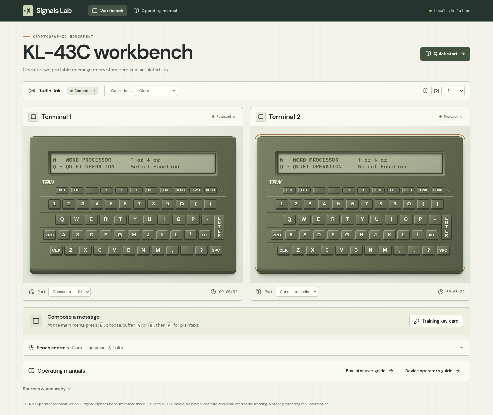

# Signals Lab · KL-43C workbench

Two independently operated TRW KL-43C reconstructions share a simulated simplex link. The photographed 59-key faceplates and two-line displays replace the earlier KIPLING design. The operating baseline is TRW manual 410-308-1, Revision F, 15 August 1991.

**Start with the manuals.** The app opens on the equipment. Select **Quick start** for a complete exchange, or **Operating manual** for two searchable guides. Print this guide prints the whole selected manual, including chapters outside the current view.

- [Device operator’s guide](docs/DEVICE_MANUAL.md) — power, keys, editing, encryption, communications, clock, authentication, printing and recovery.
- [Emulator user guide](docs/EMULATOR_MANUAL.md) — browser controls, link, faults, keyboard mapping, simulated time and state retention.
- [First exchange quick reference](docs/OPERATOR_GUIDE.md).



## Run the application

Install Node.js 24 LTS, which includes npm. Open a terminal in the folder containing package.json and run:

```sh
npm ci
npm run dev
```

Open the local URL printed by Vite. On Windows, use Windows Terminal or Command Prompt. If PowerShell blocks npm.ps1, run npm.cmd ci and npm.cmd run dev. For a port conflict, run npm run dev -- --port 5174. If tsc, vite or Node type declarations are missing, run npm ci --include=dev in the repository folder. Keep package-lock.json in place.

## Build and deploy

```sh
npm run build
npm run preview
```

Copy **the contents of dist/**, including index.html and assets/, to an ordinary static web server. Relative asset paths support hosting under a subdirectory, for example /exhibits/kl43/. The deployed application needs a browser and static files. All runtime fonts, icons, manuals and code are local assets.

The build also refreshes KIPLING.html at the repository root, a single-file distribution retaining the existing filename. Serve it from a static web server or localhost. The test suite serves the built application with a plain Node HTTP server at both the root and a nested path. Browser file-scheme behaviour is outside the verified configuration.

## Validation

```sh
npm run typecheck
npm run lint
npm test
npm run coverage
npm run build
npx playwright install chromium
npm run e2e
```

To reuse system Chromium, set CHROMIUM_PATH to its executable. In PowerShell, for example, set $env:CHROMIUM_PATH to the installed executable path before running npm run e2e. To regenerate the screenshots, also set CAPTURE to 1. Browser tests reserve localhost port 5184 and use the production build. Versions are fixed by the lockfile. Tests use virtual time and local inputs. Coverage fails below 95% statements or branches across the domain modules.

## Implementation and evidence

- [Device specification and printed/PDF page concordance](docs/KL43C_SPEC.md)
- [Evidence, conflicts and reconstruction assumptions](docs/ASSUMPTIONS.md)
- [Substitute cryptography and printable format](docs/CRYPTO_SIMULATION.md)
- [Verification and manual coverage](docs/MANUAL_COVERAGE.md) · [machine-readable requirement map](docs/manual-coverage.json)
- [Narrow-screen layout](docs/screenshots/mobile.png)

The training provider uses real DES-CFB8 with a self-contained printable envelope. The receiver uses its own key to decrypt. The original cipher, validity check, update procedure, authentication algorithm and wire protocol are unknown. This release serves a historical teaching purpose. Protect real information with current, supported systems.
